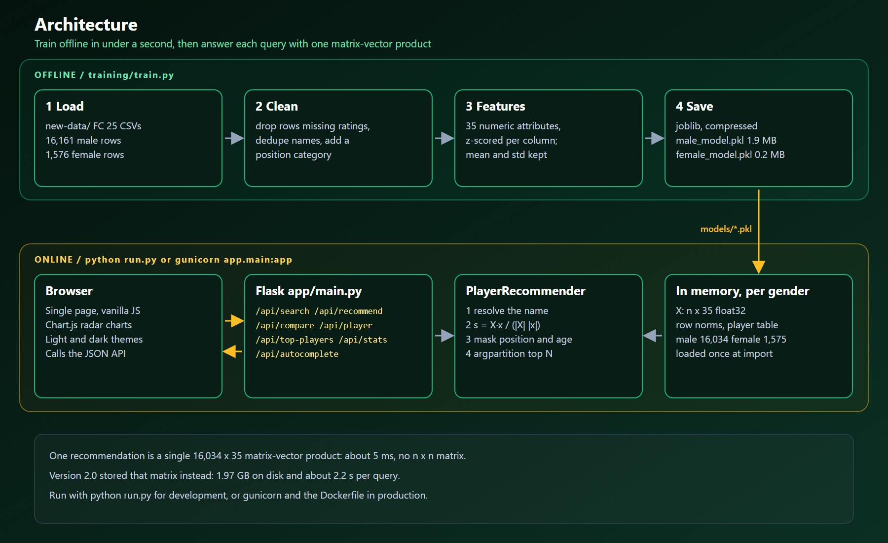

# Technical Reference

How the FIFA Player Recommendation System is built, why it is built that way, and the full API contract. For setup, see [README.md](README.md) and [INSTALL.md](INSTALL.md).

## Contents

1. [Architecture](#architecture)
2. [Data pipeline](#data-pipeline)
3. [Recommendation algorithm](#recommendation-algorithm)
4. [Model file format](#model-file-format)
5. [API reference](#api-reference)
6. [Frontend](#frontend)
7. [Design decisions](#design-decisions)
8. [Limitations and roadmap](#limitations-and-roadmap)

## Architecture



| Layer | Code | Responsibility |
|-------|------|----------------|
| Data | `src/data_processing.py` | `DataProcessor`: load CSV, clean, categorize positions, extract and standardize 35 features, format cards and radar data |
| Model | `src/model.py` | `PlayerRecommender`: similarity, filters, search, top players, save and load |
| Training | `training/train.py` | Builds `models/male_model.pkl` and `models/female_model.pkl` and smoke-tests each |
| API | `app/main.py` | Flask app, JSON endpoints, input bounds, error handling; loads both models at import |
| UI | `app/templates/index.html`, `app/static/` | Single-page app in vanilla JavaScript with Chart.js radar charts |

Men's and women's players live in two independent models. Every request names a `gender` and is answered from that model only.

## Data pipeline

### Input

`new-data/male_players.csv` (16,161 rows) and `new-data/female_players.csv` (1,576 rows), EA SPORTS FC 25 ratings with 50+ columns: ratings, the six face stats, 29 detailed attributes, five goalkeeper attributes, position, alternative positions, foot, weak foot, skill moves, height, weight, age, nation, league, team, play styles and a source URL.

### Cleaning (`DataProcessor.clean_data`)

1. Drop rows missing `Name`, `OVR`, `Position` or any feature column.
2. Fill display columns: `Age` 0, `Nation` and `League` "Unknown", `Team` "Free Agent", `Preferred foot` "Right", `Weak foot` 3, `Skill moves` 2, `Height` and `Weight` "N/A".
3. Coerce feature columns to numbers.
4. Drop duplicate names, keeping the first (highest ranked) row.

This leaves 16,034 men's and 1,575 women's players.

### Position groups

| Group | Positions |
|-------|-----------|
| Goalkeeper | GK |
| Defender | CB, LB, RB, LWB, RWB |
| Midfielder | CDM, CM, CAM, LM, RM |
| Forward | ST, CF, LW, RW, LF, RF |

### Features (35)

| Group | Attributes |
|-------|------------|
| Face stats | PAC, SHO, PAS, DRI, DEF, PHY |
| Pace | Acceleration, Sprint Speed |
| Shooting | Positioning, Finishing, Shot Power, Long Shots, Volleys, Penalties |
| Passing | Vision, Crossing, Free Kick Accuracy, Short Passing, Long Passing, Curve |
| Dribbling | Dribbling, Agility, Balance, Reactions, Ball Control, Composure |
| Defending | Interceptions, Heading Accuracy, Def Awareness, Standing Tackle, Sliding Tackle |
| Physical | Jumping, Stamina, Strength, Aggression |

### Standardization

```python
mean = features.mean(axis=0)
std = features.std(axis=0)
std[std == 0] = 1
normalized = (features - mean) / std
```

The mean and std are stored with the model so that `recommend_by_attributes` scales a hand-written target exactly like the training data.

## Recommendation algorithm

Content-based filtering with cosine similarity on standardized attributes.

```
similarity(a, b) = (a · b) / (|a| |b|)
```

For a query player with feature row `x`:

1. **Resolve the name.** Exact case-insensitive match, otherwise the highest-rated player whose name contains the query.
2. **Score.** `scores = X @ x / (norms * |x|)`, where `X` is the n x 35 float32 matrix and `norms` are row norms computed once at load.
3. **Filter.** A boolean mask removes the player, players outside the position group (`same_position`, default on) and players more than `max_age_diff` years apart (optional).
4. **Rank.** `np.argpartition` finds the top N, which are then sorted. Only those N rows are converted to dictionaries.

**Cost per query:** O(n·d) arithmetic with n = 16,034 and d = 35, about 560,000 multiply-adds: around 5 ms including pandas overhead. Memory is O(n·d), about 2.2 MB for the men's feature matrix.

**Why standardize?** Every rating is positive, so raw or min-max scaled vectors sit in one corner of the space and almost all cosine scores fall between 0.99 and 1.00. After centering, the cosine measures whether two players are above or below average on the same attributes, which separates roles and levels much better:

| Query | Min-max top 5 | Standardized top 5 |
|-------|---------------|--------------------|
| Rodri | Locatelli, Cristante, Escalante, Lončar (70), Partey | Locatelli, Merino, Tchouaméni, Rice, Guimarães |
| Thibaut Courtois | Remiro, Baumann, Conde (73), Donnarumma, Consigli | Donnarumma, Remiro, Oblak, Soria, Baumann |
| Aitana Bonmatí | Däbritz, Nagasato, DiBernardo, Nobbs, Pinto | Nagasato, Putellas, Däbritz, DiBernardo, Giugliano |

**Custom targets.** `recommend_by_attributes({"PAC": 90, ...}, position="Forward")` fills unspecified attributes with the dataset mean, standardizes the vector with the stored statistics and ranks players the same way.

## Model file format

A joblib file (compression level 3) holding a dictionary:

| Key | Type | Content |
|-----|------|---------|
| `data` | `pandas.DataFrame` | Cleaned player table plus `Position_Category` |
| `normalized_features` | `float32` array, n x 35 | Standardized feature matrix |
| `feature_names` | `list[str]` | The 35 column names, in matrix order |
| `feature_mean` | `float64` array, 35 | Per-feature mean |
| `feature_std` | `float64` array, 35 | Per-feature standard deviation |

Version 2.0 files also contain `similarity_matrix` and min-max scaled features. `PlayerRecommender.load` ignores the matrix and re-standardizes from `data`, so they keep working until retrained.

Model files are Python pickles. Load only files you trained yourself or fully trust. See [SECURITY.md](SECURITY.md).

## API reference

All responses are JSON. `gender` is `male` (default) or `female`.

### `POST /api/recommend`

| Field | Type | Default | Notes |
|-------|------|---------|-------|
| `player_name` | string | required | Exact or partial, case-insensitive |
| `n_recommendations` | int | 10 | 1 to 100 |
| `same_position` | bool | true | Restrict to the player's position group |
| `max_age_diff` | int | none | Maximum age gap in years |

Returns `source_player` and `recommendations`. Each player has `name`, `overall`, `position`, `age`, `nation`, `league`, `team`, `pace`, `shooting`, `passing`, `dribbling`, `defending`, `physical`; recommendations add `similarity` as a percentage with one decimal. `400` without a name, `404` when the player is unknown.

### `POST /api/search`

| Field | Type | Notes |
|-------|------|-------|
| `query` | string | Substring of the name |
| `position` | string | Substring of the position, e.g. `CB` |
| `min_overall`, `max_overall` | int | Rating range; invalid values are ignored |
| `nation`, `league`, `team` | string | Case-insensitive substrings |
| `limit` | int | Default 50, 1 to 100 |

Returns `players` (same fields as above, sorted by rating) and `count`. Filter text is matched literally, not as a regular expression.

### `POST /api/compare`

Body: `{"players": ["Name 1", "Name 2", ...]}` with 2 to 4 names. Returns `players`, each with:

- `card`: `name`, `overall`, `position`, `age`, `nation`, `league`, `team`, `height`, `weight`, `preferred_foot`, `weak_foot`, `skill_moves` and the six face stats
- `radar`: `name`, `attributes` (the six face stats) and `detailed_attributes` (23 detailed attributes)

`400` for fewer than 2 or more than 4 names, `404` naming the first unknown player.

### `GET /api/player/<name>?gender=male`

Returns `player` (the card above) and `radar`. `404` when unknown.

### `GET /api/top-players?gender=male&n=100&position=Forward`

`n` is 1 to 100; `position` is a position group. Returns `players` with `name`, `overall`, `position`, `age`, `nation`, `team`.

### `GET /api/autocomplete?gender=male&query=rod&limit=10`

Returns up to `limit` (max 20) names containing `query`, in dataset order (highest ranked first). Queries shorter than two characters return an empty list.

### `GET /api/stats`

Returns `male` and `female`, each with `total_players`, `avg_overall` and `top_rated`.

### `GET /api/health`

`200 {"status": "ok", "models": {"male": true, "female": true}}` when both models are loaded, `503` with `"status": "degraded"` otherwise.

### Errors

Every error is `{"error": "message"}` with status `400`, `404`, `500` or `503`. A `500` never includes exception text; the traceback goes to the server log.

## Frontend

A single HTML page with four sections (Home, Search, Recommend, Compare), a player profile modal, a gender toggle and a light and dark theme stored in `localStorage` under `fifa-theme`. `app/static/js/app.js` calls the endpoints above with `fetch`, renders player cards, and draws radar charts with Chart.js 4. Name inputs use `/api/autocomplete` with debouncing. Icons come from Font Awesome and the font is Inter from Google Fonts.

## Design decisions

**On-demand similarity instead of a precomputed matrix.** Version 2.0 precomputed the full n x n cosine matrix to make queries "a lookup". In practice the matrix was 1.97 GB on disk for 16,034 players, took seconds to train, and the per-row Python filter loop made each query take about 2.2 s anyway. One matrix-vector product over a 16,034 x 35 matrix is cheaper than reading a 16,034-element row from that matrix through pandas, so 2.1 computes scores on demand: 1.9 MB models and about 5 ms per query.

**When to switch to approximate nearest neighbours.** Exact search scales linearly: even 300,000 players is only about 10 million multiply-adds per query, so for any football dataset it remains the simpler choice. With millions of items or hundreds of features, an index such as FAISS or Annoy becomes worthwhile. Position and age filters would then be applied to a larger candidate set from the index.

**Separate models per gender.** The two pools have different rating distributions, so each is standardized on its own data and never mixed.

**Models load at import.** This makes the app work under any WSGI server (gunicorn, waitress) without a separate startup hook, at the cost of loading models in tests that import the app. The tests swap in a model trained on the women's dataset.

## Limitations and roadmap

- **Goalkeepers** are compared on outfield attributes. The five GK attributes are in the CSV but not used yet.
- **Name resolution** uses substring matching, so a short query can resolve to a different player than intended. The autocomplete reduces this in the UI.
- **Equal weights.** Every attribute counts the same. Role-specific weights (for example, defending attributes for centre-backs) would sharpen results.
- **Retraining** rebuilds from scratch. That is fine at under a second, but a newer dataset needs the same column names.

Contributions in any of these areas are welcome. See [CONTRIBUTING.md](CONTRIBUTING.md).
