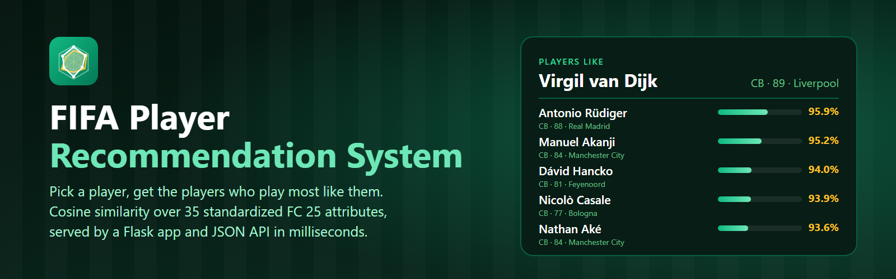
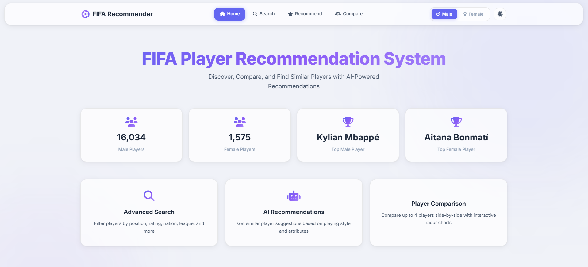
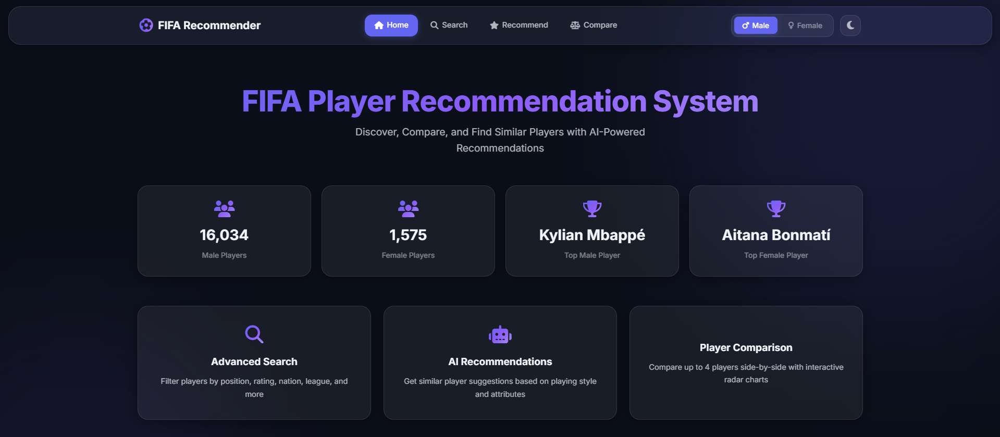
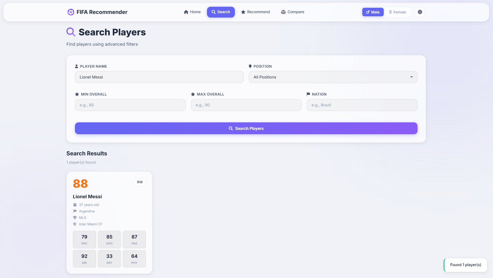
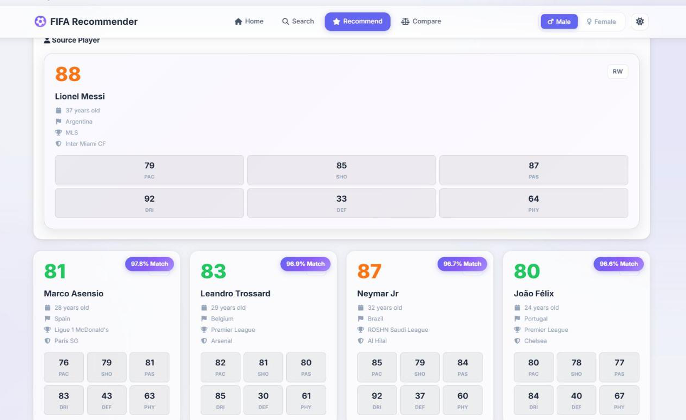
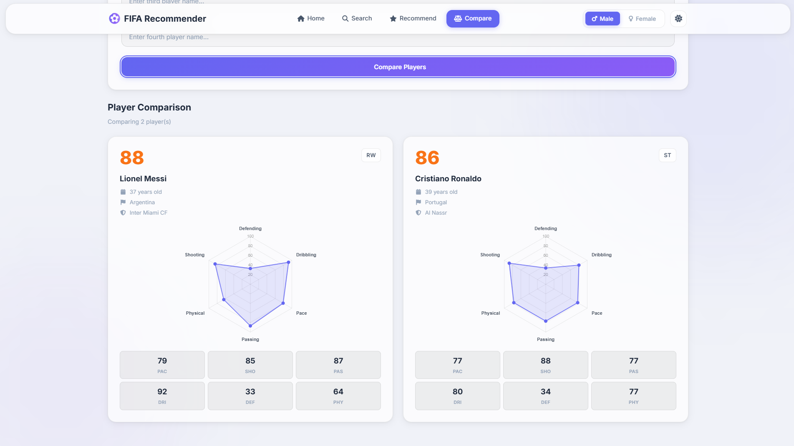
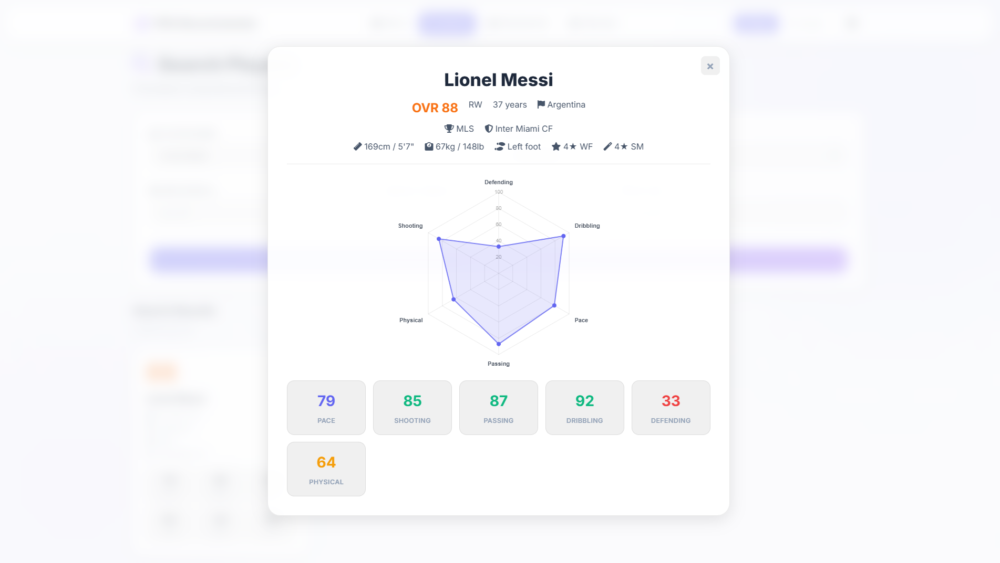
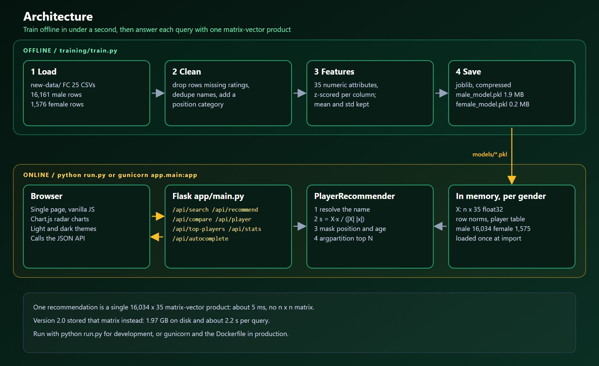

<div align="center">


# FIFA Player Recommendation System

**Find football players who play alike, compare them side by side, and serve it all as a JSON API.**<br>
Cosine similarity over 35 standardized EA SPORTS FC 25 attributes, for 16,034 men's and 1,575 women's players, behind a Flask app that answers in milliseconds.

[](https://www.python.org/)
[](https://flask.palletsprojects.com/)
[](#deployment)
[](LICENSE)
[](https://github.com/sponsors/inboxpraveen)

</div>



## Contents

- [What it is](#what-it-is)
- [Screenshots](#screenshots)
- [How it works](#how-it-works)
- [Quick start](#quick-start)
- [Use it your way](#use-it-your-way)
- [Model training](#model-training)
- [API reference](#api-reference)
- [Configuration](#configuration)
- [Deployment](#deployment)
- [Performance](#performance)
- [Project structure](#project-structure)
- [Testing](#testing)
- [Documentation](#documentation)
- [Contributing](#contributing)
- [Sponsor](#sponsor)
- [Data and attribution](#data-and-attribution)
- [License](#license)

## What it is

Pick a player and get the players whose attribute profile is closest: same position group by default, optionally within a few years of age. Search the whole database by name, position, rating, nation, league or club, and put up to four players on one radar chart.

It is useful if you are:

- **Scouting in a football game**: find a cheaper or younger player who fills the same role.
- **Building a football product**: call the JSON API from your own site, bot or notebook.
- **Learning recommender systems**: a complete content-based recommender, from CSV to web app, that is small enough to read in an afternoon.

Men's and women's players are kept in separate models, so results never mix the two pools.

**Why it is easy to run**

- **Small models.** A trained model is the standardized feature matrix and the player table. The men's model is 1.9 MB, the women's 0.2 MB.
- **Fast without precomputation.** A recommendation is one 16,034 x 35 matrix-vector product, about 5 ms. There is no n x n similarity matrix to build, store or load.
- **Trains in under a second.** Both models build in about 0.5 s on a laptop.
- **Production ready.** It runs under gunicorn, ships with a Dockerfile, has a health endpoint, bounds every client-supplied size, and never returns internal errors to clients.
- **Tested.** A pytest suite covers the model and every API endpoint.

## Screenshots

<p align="center">
  
  &nbsp;
  
</p>

<p align="center">
  
  
  
</p>

<p align="center">
  
</p>

## How it works



**Offline**, `training/train.py` turns each CSV into a model file:

1. **Load and clean.** Drop rows missing a rating or attribute, de-duplicate names, fill display fields and map each position to Goalkeeper, Defender, Midfielder or Forward.
2. **Extract features.** 35 numeric attributes per player: the six face stats (PAC, SHO, PAS, DRI, DEF, PHY) and 29 detailed ones such as Acceleration, Vision, Composure, Def Awareness and Strength.
3. **Standardize.** Each attribute becomes a z-score using its mean and standard deviation over the dataset. The mean and std are saved with the model.
4. **Save.** The player table, the float32 feature matrix and the scaling statistics go into a compressed joblib file in `models/`.

**Online**, the Flask app loads both models once at import. For a recommendation it:

1. Resolves the name (exact, case-insensitive match first; otherwise the highest-rated partial match).
2. Scores every player with `s = X·x / (|X| |x|)`, a single matrix-vector product.
3. Masks out the player, other position groups (optional) and anyone outside the age gap (optional).
4. Picks the top N with `argpartition` and returns them as JSON.

**Why standardize first?** Ratings are all positive, so raw or min-max scaled vectors all point the same way and every cosine score lands between 99% and 100%. Centering each attribute first measures how a player differs from the average player, which is what makes two players alike. For Rodri, min-max scaling ranked a 70-rated holding midfielder in the top five; standardized features return Locatelli, Merino, Tchouaméni, Rice and Guimarães.

## Quick start

You need Python 3.11 or newer.

**With conda**

```bash
git clone https://github.com/inboxpraveen/FIFA-Player-Recomendation.git
cd FIFA-Player-Recomendation
conda create -n fifa-rec python=3.12 -y
conda activate fifa-rec
pip install -r requirements.txt
python training/train.py
python run.py
```

**With venv**

```bash
git clone https://github.com/inboxpraveen/FIFA-Player-Recomendation.git
cd FIFA-Player-Recomendation
python -m venv .venv
source .venv/bin/activate        # Windows: .venv\Scripts\activate
pip install -r requirements.txt
python training/train.py
python run.py
```

**With Docker**

```bash
docker build -t fifa-player-rec .
docker run -p 8000:8000 fifa-player-rec
```

Open http://localhost:5000 (or http://localhost:8000 for Docker). See [INSTALL.md](INSTALL.md) for details and troubleshooting.

## Use it your way

**As a web app.** Search, recommend, compare and open player profiles in the browser, in a light or dark theme.

**As a JSON API.** Every screen in the app is backed by an endpoint you can call directly:

```bash
curl -X POST http://localhost:5000/api/recommend \
  -H "Content-Type: application/json" \
  -d '{"gender": "male", "player_name": "Virgil van Dijk", "n_recommendations": 5}'
```

**As a Python library.** Load a trained model and query it in a notebook or your own service:

```python
from src.model import PlayerRecommender

model = PlayerRecommender.load("models/male_model.pkl")

for p in model.recommend_similar("Lamine Yamal", n_recommendations=5, max_age_diff=4):
    print(p["Name"], p["Position"], p["OVR"], round(p["similarity_score"] * 100, 1))

# Or describe the player you want; unspecified attributes default to the dataset average
model.recommend_by_attributes({"PAC": 90, "Dribbling": 88, "Stamina": 85}, position="Forward")
```

## Model training

```bash
python training/train.py            # both models
python training/train.py --male     # men's model only
python training/train.py --female   # women's model only
```

| Model | Players | Features | Training time | File size |
|-------|---------|----------|---------------|-----------|
| `male_model.pkl` | 16,034 | 35 | 0.4 s | 1.9 MB |
| `female_model.pkl` | 1,575 | 35 | 0.1 s | 0.2 MB |

To use a newer dataset, replace the CSVs in `new-data/` with files that have the same columns and train again. Model files from version 2.0, which contained a full similarity matrix, still load; retrain once to shrink them. See [training/README.md](training/README.md).

## API reference

All endpoints take `gender` as `male` (default) or `female` and return JSON.

| Method | Endpoint | Purpose |
|--------|----------|---------|
| `POST` | `/api/recommend` | Similar players for a named player |
| `POST` | `/api/search` | Filter by name, position, rating range, nation, league, team |
| `POST` | `/api/compare` | Cards and radar data for 2 to 4 players |
| `GET` | `/api/player/<name>` | One player's card and detailed attributes |
| `GET` | `/api/top-players?n=100&position=Forward` | Highest rated players, optionally per position group |
| `GET` | `/api/autocomplete?query=rod&limit=10` | Name suggestions (2+ characters) |
| `GET` | `/api/stats` | Player counts, average rating and top player per dataset |
| `GET` | `/api/health` | `200` when both models are loaded, `503` otherwise |

**Recommend**

```json
POST /api/recommend
{
  "gender": "male",
  "player_name": "Kylian Mbappé",
  "n_recommendations": 3,
  "same_position": true,
  "max_age_diff": 3
}
```

```json
{
  "success": true,
  "source_player": { "name": "Kylian Mbappé", "position": "ST", "overall": 91, "age": 25, "team": "Real Madrid", "...": "..." },
  "recommendations": [
    { "name": "Matheus Cunha", "position": "ST", "overall": 79, "age": 25, "team": "Wolves", "similarity": 98.4, "...": "..." },
    { "name": "Albert Guðmundsson", "position": "ST", "overall": 80, "age": 27, "team": "Fiorentina", "similarity": 98.3, "...": "..." },
    { "name": "Luis Díaz", "position": "LW", "overall": 84, "age": 27, "team": "Liverpool", "similarity": 98.2, "...": "..." }
  ]
}
```

Each player object also carries `nation`, `league` and the six face stats (`pace`, `shooting`, `passing`, `dribbling`, `defending`, `physical`).

**Search**

```json
POST /api/search
{ "gender": "female", "query": "bonmat", "min_overall": 85, "limit": 5 }
```

Every field except `gender` is optional. Text filters are case-insensitive substring matches. `limit`, `n` and `n_recommendations` are capped at 100 and autocomplete at 20.

Unknown players return `404`, invalid requests `400`, and unexpected failures a generic `500` with the details written to the server log only. [PROJECT_SUMMARY.md](PROJECT_SUMMARY.md) documents every request and response field.

## Configuration

| Variable | Default | Used by |
|----------|---------|---------|
| `HOST` | `127.0.0.1` | `python run.py`. Set `0.0.0.0` to accept connections from other machines. |
| `PORT` | `5000` | `python run.py` |
| `MODELS_DIR` | `models/` | Where the app looks for `male_model.pkl` and `female_model.pkl` |
| `FLASK_DEBUG` | unset | `python app/main.py` only. Set `1` for the debugger; never in production. |

## Deployment

The models load when `app.main` is imported, so any WSGI server works.

**Docker** trains the models during the build, runs gunicorn with two workers as a non-root user on port 8000, and reports health through `/api/health`:

```bash
docker build -t fifa-player-rec .
docker run -d -p 8000:8000 --name fifa-player-rec fifa-player-rec
```

**gunicorn** on Linux or macOS:

```bash
python training/train.py
gunicorn --bind 0.0.0.0:8000 --workers 2 app.main:app
```

On Windows, use `pip install waitress` and `waitress-serve --port=8000 app.main:app`, or the Docker image.

Each worker holds both models in memory, about 115 MB per worker including Python and pandas. Put a reverse proxy such as nginx or your platform's load balancer in front for HTTPS. See [SECURITY.md](SECURITY.md) before exposing it publicly.

## Performance

Measured with the Flask test client on an Intel Core i7-14650HX laptop, 50 requests per endpoint against the men's model (16,034 players):

| Endpoint | Median | p95 |
|----------|--------|-----|
| `POST /api/recommend` (top 10, same position) | 6.1 ms | 8.2 ms |
| `POST /api/search` (name and rating filters) | 13.1 ms | 15.7 ms |
| `POST /api/compare` (4 players) | 5.4 ms | 7.3 ms |
| `GET /api/player/<name>` | 1.5 ms | 2.5 ms |
| `GET /api/top-players` (100) | 5.4 ms | 7.2 ms |
| `GET /api/autocomplete` | 6.7 ms | 10.3 ms |

Version 2.1 against 2.0 on the same machine:

| | 2.0 (precomputed matrix) | 2.1 (on demand) |
|---|---|---|
| Men's model on disk | 1.97 GB | 1.9 MB |
| Recommendation | about 2,200 ms | about 5 ms |
| Training, both models | 5.7 s | 0.5 s |
| Model load | 0.74 s | 0.06 s |

## Project structure

```
FIFA-Player-Recomendation/
├── app/
│   ├── main.py                 # Flask app and JSON API
│   ├── static/                 # CSS, JavaScript, logo
│   └── templates/index.html    # Single-page UI
├── src/
│   ├── data_processing.py      # Cleaning, features, standardization
│   ├── model.py                # PlayerRecommender
│   └── utils.py                # Formatting helpers
├── training/
│   ├── train.py                # Builds models/*.pkl
│   └── README.md               # Training guide
├── new-data/                   # FC 25 player CSVs
├── models/                     # Trained models (generated, git-ignored)
├── tests/                      # pytest suite
├── assets/                     # Logo, banner, diagram, screenshots
├── Dockerfile
├── run.py                      # Development launcher
└── requirements.txt
```

## Testing

```bash
pip install pytest
python -m pytest
```

The suite trains on the women's dataset in under a second, so it does not need `models/`. It checks ranking against a brute-force cosine calculation, the position and age filters, loading of 2.0 model files, and every endpoint, including input validation and error handling.

## Documentation

- [INSTALL.md](INSTALL.md): installation, troubleshooting, uninstalling
- [training/README.md](training/README.md): training options and the algorithm
- [PROJECT_SUMMARY.md](PROJECT_SUMMARY.md): technical reference and full API
- [CONTRIBUTING.md](CONTRIBUTING.md): development setup and pull requests
- [SECURITY.md](SECURITY.md): reporting vulnerabilities and deployment notes
- [CHANGELOG.md](CHANGELOG.md): release history

## Contributing

Issues and pull requests are welcome. Good first areas: a better name matcher for accented and duplicate names, per-attribute weights for different roles, goalkeeper-specific attributes, and support for newer FC datasets. Please read [CONTRIBUTING.md](CONTRIBUTING.md) and run the tests before opening a pull request.

## Sponsor

This project is maintained by one person. If it saves you time, or you use it in a product, a stream or a class, [sponsoring](https://github.com/sponsors/inboxpraveen) helps keep the dataset current, dependencies updated and issues answered. Starring the repository and sharing it helps as well.

## Data and attribution

Player ratings and attributes come from EA SPORTS FC 25. The `url` column in each CSV links to the player's page on [ea.com](https://www.ea.com/games/ea-sports-fc/ratings).

This is an independent fan and educational project. It is not affiliated with, endorsed by or sponsored by Electronic Arts, EA SPORTS or FIFA. All player names, ratings and trademarks belong to their respective owners. The MIT license covers this project's source code, not the player data.

## License

MIT. See [LICENSE](LICENSE).

**Author:** Praveen Kumar · [Portfolio](https://inboxpraveen.github.io/) · [GitHub](https://github.com/inboxpraveen) · [LinkedIn](https://www.linkedin.com/in/praveen-kumar-inbox/) · [X](https://x.com/InboxPraveen)
